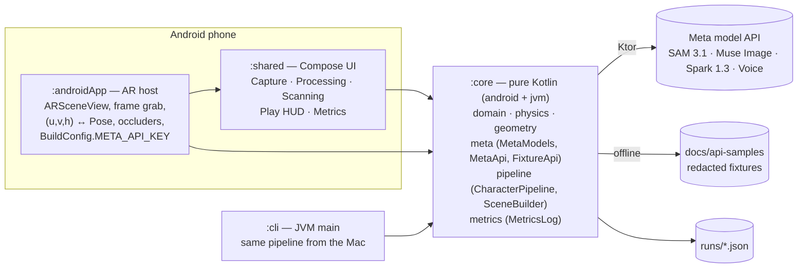

# Rudeus architecture



## Boundaries that keep the hackathon safe
- **`:core` knows nothing about Android, Compose or ARCore.** It is testable on the JVM in seconds and the CLI runs the
  exact code the phone runs. Everything that can be wrong in a way a test can catch lives here.
- **`:shared` is UI only.** It receives the AR view as a slot composable and domain data from `:core`; it never calls the network.
- **`:androidApp` is the only place with AR types** and the only place that converts between ARCore poses and plane
  coordinates. It is hand-written and hand-reviewed; agents draft, a human runs it on the Pixel.

## Coordinate system
The first plane tap creates the session's single anchor. Its pose is the level frame: local **X = u**, local **Z = v**,
local **Y = h** (up), all in metres. `:core` only ever sees `(u, v, h)`.

```
planeCoords(anchor, worldPose) = anchor.pose.inverse() ∘ worldPose  →  (tx, tz)
toWorld(anchor, (u, v), h)     = anchor.pose ∘ translation(u, h, v)
```

## Scan: how the table becomes a level
1. Player presses **Scan** (never per-frame). The app grabs one camera image and stores the camera pose, intrinsics,
   the anchor pose and the plane polygon as `ScanInput`.
2. `MetaModels.segment` returns one mask per prompt (cup, book, phone, bottle, hand, object).
3. `SceneBuilder`: mask → largest component → contour → Douglas–Peucker → base points → ray–plane → footprint polygon;
   height from the top-edge ray; `Semantics.kindFor(label, h)`; ids matched to the previous level by centroid.
4. `Physics.step` routes the character: push-out from obstacles, step-up onto ≤ 4 cm platforms, fall and respawn past the
   plane boundary, jump parabola, fly/roll abilities.

## Character pipeline (same code on phone and CLI)
cutout (SAM) → stylize (Muse Image, ≤ 9 refs) → gate (Spark vision score × 0.6 + deterministic palette/outline × 0.4,
threshold 0.7, ≤ 2 retries) → sheet (Spark: name, personality, ability, 5 lines kk/ru). Every stage is timed and costed
into `MetricsLog`; `runs/<runId>.json` is the only source for README numbers.

## Offline mode
`FixtureApi` implements the same `MetaModels` interface from `docs/api-samples/` (CLI, tests) or bundled assets (phone).
A network error switches the session to it; the HUD shows the offline badge.

## Dev loop
- Domain: `./gradlew :core:jvmTest` (seconds). Pipeline: `./gradlew :cli:run --args="character --fixtures docs/api-samples --out runs --all"`.
- AR without the table: ARCore Recording & Playback (`ARSceneView(playbackDataset = …)`).
- Definition of done: `scripts/verify.sh`.
